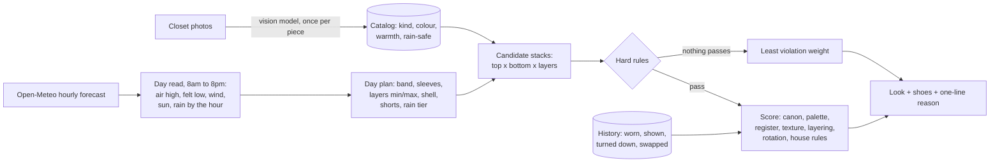

# Daily Fit

**A closet that dresses you.** Photograph your clothes once. Every morning it reads the hourly forecast where you are, picks an outfit from what is actually clean, and sends one notification.

**Live:** [daily-fit-pearl.vercel.app](https://daily-fit-pearl.vercel.app) (sign in with a phone number)

I built it because I kept wearing the same five things. The hard part turned out not to be the app. It was making a rule engine whose picks a person would actually walk out the door in, and proving that with tests instead of taste.

## What makes it interesting

- **A deterministic outfit engine, not an LLM call.** Vision models catalog each photo once. After that, every pick comes from about 40 small TypeScript modules: temperature bands, a layering model, a formality scale, a colour model, and a rotation memory. A pick takes about 100 ms and can explain itself.
- **Rules derived from research.** Three research passes over roughly 150 menswear, outdoor-gear, and weather sources were turned into numeric rules, each one traceable to where it came from.
- **Hard rules and soft scores are separate.** "No long sleeve above 70°F" is a rule a look either passes or fails. "Light against dark" is a score. When nothing clean passes, every violation carries a weight and the least bad look goes out, labelled as such.
- **Tested adversarially.** 201 tests, including two seeded property-based fuzz suites that generate thousands of random closets and forecasts and check engine invariants. They found 15 real bugs, each now pinned as a regression test.
- **Evaluated like a model.** A script dumps what the engine picks from a real closet across 26 weather and occasion scenarios. Independent reviewers graded all 260 looks blind, before and after a round of fixes.

| Blind grade of 260 looks | A | B | C | D |
|---|---|---|---|---|
| Before the fix round | 31% | 44% | 20% | 5% |
| After | 36% | 54% | 10% | 0.4% |

## How a look gets picked



### 1. Reading the day

The engine does not dress for the daily high. It reads the forecast hour by hour for the hours a person is out and derives two things:

- **The band** comes from the air high (85, 78, 71, 65, 58, 50°F), shifted five degrees cooler when the sky is overcast.
- **Whether a layer is needed** comes from the felt low: air temperature, minus wind, plus sun, minus fog.

That split is what handles a Bay Area day. A 54° foggy morning before a 76° afternoon gets a short sleeve and one jacket that comes off by ten. A steady 76° gets no layer at all.

### 2. Layering as a model

Every piece has a role: base, mid, or shell. A stack is read inner to outer and each adjacent pair is either forbidden or scored.

- **Forbidden:** a hoodie over a collar, a mid over a mid, two hoods, linen under wool or fleece, a jersey under a shirt jacket.
- **Rewarded:** a tee under a shirt jacket, an oxford under a cotton quarter-zip, a thermal under anything.
- **By temperature:** a cool day needs one warm piece, a cold day a long sleeve or a tee under a mid, and a freezing or rainy day three pieces with a jacket that can take the weather.

### 3. What "looks good" means, in code

- **Register.** Every piece sits on a 1 to 4 scale: athletic, sweats, campus casual, smart casual. Pieces two levels apart cost, three apart are out.
- **Palette.** Neutrals plus at most one accent, value contrast between top and bottom, classic pairs rewarded, known clashes penalised. Colour is read from a piece's main colour, so a logo does not count as an outfit colour.
- **Canon.** A matrix of top kind by bottom kind: a tee on chinos, an oxford on chinos, a hoodie on joggers, never a polo on sweatpants.
- **Rotation.** A worn stack sits out two weeks, a turned-down one ten days. Yesterday's top rests. The kind of top rotates too, so it is not polos four days running.

### 4. Feedback without a learned model

An earlier version learned taste from swipes and collapsed into suggesting the same outfits. I deleted it. Feedback is now small, capped nudges: "I like this look" and "Not this" each move a kind of pairing by a bounded amount that can never override the weather or bring a stack back early.

## Product

- **Today:** the look, every piece shown, with a one-line reason. Swap any single piece, ask for another look, or mark it worn.
- **Wash tracking:** after wearing, each piece is marked wash or still good. Dirty pieces leave the pool.
- **Events:** type "an interview" or "the gym" and it dresses for that, in that day's weather.
- **Shop:** a coded gap analysis finds what the closet cannot do yet, and a model only writes the specific piece. One idea arrives each Sunday.
- **Notifications:** web push to an installed PWA at the hour you choose. An evening hour dresses tomorrow.

## Engineering notes

- **Concurrency.** Making a day's look takes a Postgres advisory lock per user and day, so a reload, a double tap, or the cron racing a page open cannot create two looks or mark one as rejected.
- **No destructive writes before success.** "Another look" picks the replacement first and swaps the rows in one transaction. A failed forecast call never costs the user the look they had.
- **Stale clients are harmless.** Every form carries the id of the look it was rendered with. A page left open overnight cannot act on a look the user never saw.
- **Shoes follow clothes.** A stack is ranked on the clothes, then dressed in the best legal pair, so owning more shoes never changes which clothes win. The one deliberate exception is a hard clash.
- **Failure is graded, not hidden.** When a thin closet cannot satisfy the forecast, the engine minimises summed violation weight and says which rule it broke.

## Testing

```bash
npm test                # 201 tests, about 60 seconds
npx tsc --noEmit
npx eslint src
```

- **Unit tests** for each rule module: bands, climate, layering, palette, register, rotation.
- **Property-based fuzz suites** (`src/lib/battle.test.ts`, `src/lib/battle2.test.ts`). A seeded generator builds random closets and forecasts and asserts invariants: an unflagged look always passes the hard rules, a flagged one only goes out when brute force finds no legal stack, no stack repeats within two weeks, a swap changes exactly one slot, the same inputs always give the same output. Failures print the seed and a shrunken closet.
- **Battle corpus** (`scripts/battle.ts`). Writes what the engine picks from a real closet across 26 scenarios as Markdown, for a human or a reviewer model to grade.

## Stack

Next.js 16 (App Router, server actions), React 19, TypeScript, Prisma, Postgres and object storage on Supabase, Vercel with an hourly cron, Web Push (VAPID) with a service worker, Twilio Verify for phone sign-in, OpenAI vision and image models for cataloging and product-style photos, Open-Meteo for weather.

## Where things live

| Path | What it holds |
|---|---|
| `src/lib/bands.ts` | The day plan: forecast in, band and layer requirements out |
| `src/lib/climate.ts` | Hard rules as weighted violations |
| `src/lib/layering.ts` | Layer kinds, forbidden and rewarded pairs, what counts as removable |
| `src/lib/register.ts`, `palette.ts`, `classic.ts` | Formality, colour, and the pairing canon |
| `src/lib/rotation.ts`, `likes.ts`, `house.ts` | Memory, capped feedback, and the wearer's standing rules |
| `src/lib/pair.ts` | Candidate generation, scoring, swap |
| `src/lib/outfit.ts`, `wear.ts` | Persistence, concurrency, wear history |
| `src/lib/gaps.ts`, `shop.ts` | Closet gap analysis and suggestions |
| `src/lib/weather.ts` | Hourly forecast parsing and the felt-temperature read |

## Run it locally

```bash
git clone https://github.com/vsahasi/daily-fit.git && cd daily-fit
cp .env.example .env    # fill in Supabase, OpenAI, Twilio Verify, and VAPID keys
npm install
npx prisma db push
npm run dev
```

Open http://localhost:3000/sign-in. The engine itself needs none of those services: `npm test` runs offline.

## Build your own

This is a personal app. The closet is mine and so are some of the rules (`src/lib/house.ts` knows I rarely wear polos). It is not a product, but everything here is open and you can have your own version in two ways.

**Fork this one.** Follow "Run it locally", sign in, and photograph your clothes. Then open `src/lib/house.ts` and replace my standing rules with yours. The weather, layering, and colour rules are general and should work for any closet of casual menswear. Anything else will need its own kinds added in `src/lib/kinds.ts` and its own rows in the pairing matrix in `src/lib/classic.ts`.

**Or build it from scratch.** This is the order I would do it in again:

1. **Catalog first.** One vision call per photo, into fixed fields: kind, main colour, warmth, sleeve length, rain-safe. Read every row by hand afterwards. Most of my early bad picks came from a wrong label here (a "cotton jersey" tee read as a sports jersey), not from the scoring.
2. **Write your hard rules as sentences before any code.** Mine started as "no long sleeve above 70°F". These are the picks that make you stop trusting the app, so they are checked as pass or fail and never traded off against a score.
3. **Dress for the hours you are out, not the daily high.** Open-Meteo gives an hourly forecast for free with no key. The coldest felt hour decides whether you need a layer, and the afternoon high decides everything else.
4. **Score pairings with plain rules.** A table of which kinds of top go with which kinds of bottom, a formality number per piece, and a few colour rules get further than you would expect. Do not call a model each morning: it is slower, it costs money every day, and you cannot test it.
5. **Give it a memory early.** Without one, the best-scoring outfit wins every day. Record what was worn and what was shown and make both sit out for a while.
6. **Grade the output, not the code.** Write a script that prints what the engine picks for twenty kinds of day, read all of it, and write down every pick you would not wear. That list is the backlog.

Models work around the edges here: cataloging each photo once, cleaning up the photos, writing a style summary, and the weekly shopping idea. Picking the day's outfit makes no model call.

Questions are welcome: open an issue.

## What I would do next

- A graded benchmark in CI: fail a change that lowers the share of A and B looks on the corpus.
- Per-user rule weights learned from wear history, bounded so they cannot collapse variety again.
- Hourly re-planning, so a look made at 7am adjusts if the forecast shifts by noon.

---

Built by [Veer Sahasi](https://github.com/vsahasi). EECS + Business at UC Berkeley (M.E.T.).
